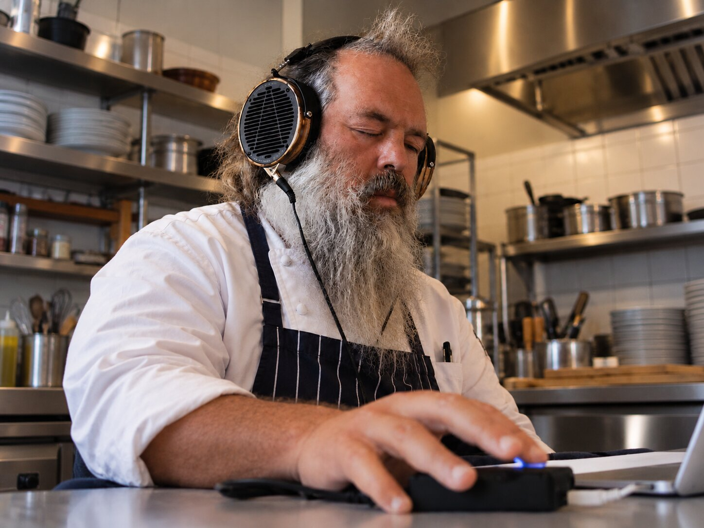
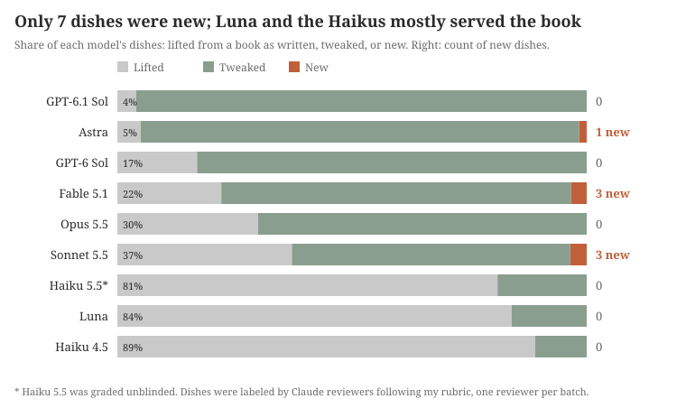

<picture><source srcset="/assets/images/flavor/chef-rubin.webp" type="image/webp"></picture>

I graded 180 menus (160 of them blind) containing 704 dishes and 37 drinks generated by LLMs and then picked winners in 45 head-to-head matchups between my top 10. If you just want some cool menu ideas and recipes, skip on down to the [appendix](#appendix). 

## TL;DR
Quick takeaways, quirky model behaviors:
1. Claude Fable 5.1 wrote my favorite menus overall, and Opus 5.5 was second. 
> 2. Creativity comes from [single leaps](#mr-potato-head-and-actually-new-dishes): clever swaps that notice that a lot of cuisines have similar components. My favorite example was in a New Mexico green chile cheeseburger: Fable subbed the chiles for naam phrik num, a thai green chile relish.
3. Claude Opus 5.5 loves duck! It put duck on the menu in 13 of the 15 menus it wrote from scratch. 
4. Only 7 of the dishes were actually new, the rest were book recipes as written or lightly tweaked.
5. The worst ideas aren't gross, just uninteresting, or lifted from a book and dropped into a menu.
6. I don't think I elicited creativity from the models particularly well, but I'm going to keep poking at this. Next time, I'm going to ask for individual dishes and specify that novelty is a grading criterion. That being said, this seems like a solid baseline of what the models do with a relatively open-ended prompt (see the [appendix](#appendix) for the prompts I used and my favorite menus of the bunch). 


## Setup
I have my cookbook collection exposed via an MCP server so I can search through it easily with the help of an LLM. Sometimes, I'll try to see how creative the models are and I'll ask them to come up with new dishes. 


I've noodled around a few times with the models, mostly Claude, and they seem to go in and out of having great ideas. A model will get a few in a row where I'll think "now we've got it" and then it'll swing back to fLaVoRs oF tHe sAlIsH sEa (almost always a dashi and salmon dish, sometimes with some mushrooms poached in the dashi, sometimes not)[^1] without warning, or give a lame, obvious idea like subbing in Walla Walla sweets as the onion for an [Oklahoma fried onion burger](https://en.wikipedia.org/wiki/Oklahoma_onion_burger).

Instead of just vibes, I wanted to be a little more systematic about how I'm testing them (and eventually put together a rubric for LLM-as-a-judge), even if my grades were still vibes-based. I used Claude a bunch to help me read through the traces after I noticed patterns in the menus and transcripts.

I evaluated the following models: Claude Fable 5.1, Opus 5.5, Sonnet 5.5, Haiku 4.5, GPT-6 Sol, GPT-6.1 Sol, GPT-6 Astra, GPT-6 Luna, and finally Haiku 5.5, which came out after I'd graded all of the menus from the rest of the models.

There were four runs,
1. The prompt as written (base). The gist is "You have a collection of cookbooks collected by a former chef available to you as an MCP server, try to come up with a menu."
2. Pushback. After the base menu is written, on the next user turn we said "That's about the menu I'd have expected. Show me what you'd make if that one were off the table: same rules, same answer layout, a complete new menu."
3. Seeded. The base prompt plus three randomly picked books to start from. Models were allowed to use other books in addition to these three.
4. Hidden. The base prompt, but the MCP server swapped every book title and author for an alias like "Book 07," so the models couldn't lean on famous names like Noma or The French Laundry.


I shuffled the menus, hid the model names, and graded them in a web interface for more ergonomic scoring. I was trying to grade them for creativity as much as possible, but also for coherence and whether they sounded good. See the [caveats](#caveats) below for more on this. I gave each menu a score from 1 to 5 and a yes/no "would I cook this." I think the "would I cook this" ended up being low signal honestly. I really would cook most of the things in my books, and since most of the menus are just the recipes in a specific order, I ended up using it as a tiebreaker for the menus I graded 3s. Once everything was scored, the page took my top 10 by score (with "would I cook this" breaking ties) and had me pick a winner in every pairing: a 45-matchup round robin.

Haiku 5.5 came out like the day after I had graded all the menus, so both 4.5 and 5.5 are included here. That also meant that 5.5 was not graded blindly; it didn't do anything that interesting anyway (mostly consolidating recipes into a menu).

The next things I'll try are asking for individual dishes (probably easier for me to grade, and it's a more realistic use) and using more models. I only ran Anthropic and OpenAI models this time, through the Claude Code CLI and the Codex CLI. 

## How the models did

Overall, Fable and Opus produced my favorite menus.


Remember that Astra, Sol, and Haiku didn't have any menus in the top 10. All of Luna's wins are from one menu from a seeded run.

Fable scored the highest in my blind 1-5 ratings, averaging 3.55, with Opus next at 3.40. All the other models landed between Haiku 4.5 at 2.70 and Astra at 3.15. We have a small sample (20 menus each), so there are relatively wide error bars. 

Menus that had a drink in them averaged a 3.54 across 35 menus versus 2.93 for the 125 menus without them. Fable and Opus both put drinks in 15/20 of their menus, but I don't think that's why I graded them higher. I think what's going on is maybe the models are thinking about the whole experience, instead of just stringing dishes together.

An extreme example of stringing dishes together with no rhyme or reason was this really bad menu from Luna:

> **Salt Air, Smoke, and Green**
>
> 1. **Oyster, lemon, and seaweed ice** — A lightly smoked oyster with its briny jelly, green herb oil, and a sharp, savory granita.
> 2. **Fire-blackened squash taco** — Roasted squash, browned pear vinaigrette, pecan crunch, and a small, hot chile relish.
> 3. **Halibut with morels and lemon** — A broad roast of fish with silky morel cream, kept deliberately smaller after the sweet squash.
> 4. **Berries in grass broth** — Fresh berries and a few lacto-fermented blueberries in a cold, grassy, verjus-bright broth.

Doesn't make any sense at all.

Most of the menus that the models generated fell into the "correct but forgettable" bucket. They're solid menus and you could throw a great dinner party with them, but nothing in them is new. Maybe this should be called the Ina Garten category. 

A lot of the menus were basically the same dinner! 
Often it was a shime saba (mackerel cured in vinegar, very delicious), then a [chawanmushi](https://en.wikipedia.org/wiki/Chawanmushi) or dashi or something with mushrooms, duck, and then some kinda convoluted dessert that could be good, but is trying too hard.

Again, there's nothing actually wrong with these. They're just fine diningslop. It's like if you lobotomized David Kinch, or made Renee Erickson's food good.

| Menu | Model | My score and comment | Courses |
|---|---|---|---|
| *Four Acids for October* | Opus | 2 ("boring.") | shime saba on rye → matsutake liquor with yellowfoot → dry-aged duck with turnips two ways → Mont Blanc over pear sherbet |
| *First Rain* | GPT-6 Sol | 2 ("nothing wrong with this one, just not interesting.") | raw scallop and apple → seared cabbage, chanterelles, mushroom broth → duck breast and fermented turnips → warm plums and buckwheat |
| *Salt, Time, Heat* | Opus | 3 ("cool first course, then the rest is like, right down the fairway") | aburi shime saba → mushroom-liquor chawanmushi → aged duck and fermented turnips → salt-roasted pear |
| *After the First Rain* | GPT-6.1 Sol | 3 ("again, would make, isn't creative.") | celeriac and chicories → mushroom custard with chanterelles → duck steak → ember pear and buckwheat gelato |


Out of the 160 blind menus, duck was in 41, chanterelles in 24, mackerel in 21, fermented turnips in 17, and matsutake in 15. Eleven menus used the [Bamboo](https://punchdrink.com/recipes/bamboo/). [*Sea and Smoke*](https://www.betterworldbooks.com/product/detail/sea-and-smoke-flavors-from-the-untamed-pacific-northwest-9780762453788)'s "Fermented Turnips with Very Aged Duck" and its matsutake broth show up in Opus, Fable and GPT-6 Sol menus alike. I'd noticed this kind of behavior, where the models reach for the same few books often, which is why we added the "seeded" menus. 

### Different conditions, different menus? 

I was hoping that constraining the models a little more would help them stretch their creative legs. Unfortunately, the seeded menus scored about the same, 3.12 against 3.10. Seeding did cut duck from 17/40 menus in the base run to 5/40, and mackerel from 9 to 3.

When we hid the book titles, the quality fell a quarter point (especially for Luna: 3.40 base down to 1.80 hidden). Duck still appeared in 17/40 menus, and mackerel in 7 of them, so the models were excited about duck and mackerel regardless of who wrote the recipe.

After pushback, the models never repeated duck from the first menu, but the new menus get repeats: green banana escabeche and rabbit are each in 4/40 of the second menus and in none of the first ones, and chochoyotes (masa dumplings) and chicken liver are in 2 each. Overall, the second menus scored about the same as the first (3.17 against 3.10), and Sonnet dropped from 3.00 to 2.60. Pushback helped Opus score better, going from 3.00 to 3.80.[^5]


## Quirks

**Tired**: Brangelina, Johnny and June Carter, and John and Yoko.


**Wired**: Opus and duck, Astra and pears, and an unlikely throuple: Sonnet, nixtamalized corn, and koji.


Sonnet gets its penchants from [*The Noma Guide to Fermentation*](https://booklarder.com/products/the-noma-guide-to-fermentation-foundations-of-flavor) ([koji](https://en.wikipedia.org/wiki/Aspergillus_oryzae)) and [*Masa*](https://booklarder.com/products/masa-techniques-recipes-and-reflections-on-a-timeless-staple) ([nixtamalization](https://en.wikipedia.org/wiki/Nixtamalization)). It usually lists all the books in the collection (about 60 at the time of benchmarking) and then goes looking for both: corn in some form (masa, hominy, tortillas) is a course in 11 of its 20 menus and koji in 9. Only 1 of its 5 seeded menus has either. 


In each of the 10 base and hidden runs, Opus opens with a search for autumn game (eight of the ten literally say "game birds"). Its mind was on the season, with searches like "autumn dinner, mushrooms, squash, game birds." While I have recipes for quail, squab, and grouse, they didn't come up in the searches. In 7 of them, it searches for duck next. Duck ends up in all 10 of those menus, and 13/15 of the first-turn menus overall. Most of the other models get duck from searches for dashi, koji or fermentation.


Fable had some high-concept shit in there, a handful revolving around acids and pH. One menu was called "No Lemon: A Dinner in Four Acids." In another, "Both Kinds of Lime," it told me "I've settled on a thread (pH as the hidden hand -- alkali-made things paired with distinct acids)," the two limes being the fruit and pickling lime, or cal, calcium hydroxide. A third was called "Five Slow Transformations: an October dinner for six." A little too froufrou for me, but the dishes it made were solid. I think it's just not where I am in my cooking life right now. At one point, these would've been slam dunks and I might've rolled my eyes at a burger.

While some of Fable's menus were groan-worthy, there were moments of excellence. 

Fable had the best, most cohesive menu idea: "Panch: a Lowcountry thali for six" (see the [appendix](#panch-a-lowcountry-thali-for-six) for the whole thing), mixing [*Amrikan*](https://booklarder.com/products/amrikan-125-recipes-from-the-indian-american-diaspora) with Sean Brock's [*South*](https://www.kitchenartsandletters.com/products/south-essential-recipes-and-new-explorations) and [*Heritage*](https://www.kitchenartsandletters.com/products/heritage-c) brilliantly. It writes that a [thali](https://en.wikipedia.org/wiki/Thali) and a Southern [meat-and-three](https://en.wikipedia.org/wiki/Meat_and_three) "are the same format: plain starch in the middle, a wet legume, a sauce, a bitter green, a dry vegetable and a pickle."

It has a similar moment with the [naam phrik num](https://en.wikipedia.org/wiki/Nam_phrik_num) cheeseburger (it's slopped up, and if you go down to the whole section in the [appendix](#whiskey-soda-counter), it's not pure brilliance but the idea is good):

> - **Pok Pok: The Drinking Food of Thailand (Ricker):** the format and three flavor systems...
>   - *Naam phrik num* is the burger's only condiment. Ricker serves it with fried meat, pork cracklings and pickled greens, which is the cheeseburger-and-pickle structure already.
> - **The Great American Burger Book (Motz):** the burger's mechanics...
>   - The New Mexico green chile cheeseburger's architecture: chile on the patty, cheese over it as glue, and nothing else.


Astra finished third by average score, but it just doesn't seem to be as lively as Fable and Opus. It searches for "subtle" or "restrained" autumn dinners with bitter vegetables, clear broths, and fruit desserts in all ten base and hidden runs. That gives me the feeling that it's trying to model what I think would be good a little too much, instead of thinking for itself (it says I'm a former chef in the prompt). I should probably try to elicit this model better, I'd guess the GPT models need more encouraging in general based off of their personalities. It has some things that Claude thought were lucid and "good editing," but it seems like midwit slop to me mostly (but maybe I'm the midwit)[^2]. Astra calls three menus "After the First Rain" (a title both Sols also reached for once) and ends up using pears in 13/15 menus ([shout out to all the pear eaters](https://www.youtube.com/watch?v=4rGvJBuVH_k&t=125s)). Balancing bitterness with sweetness is *not* a new or interesting idea (6/10 base and hidden menus talk about that concept). It's just boring!


Finally, Fable and Opus are total lushes! Drinks showed up in 30 of their 40 menus (15 each). Nothing all that inspiring, cocktail-wise, and I don't think anything new, but it was a nice gesture. 

## Mr. Potato Head and Actually New Dishes 

<picture><source srcset="/assets/images/flavor/mr-mrs-potato-head.webp" type="image/webp"></picture>

The best ideas that the models had were [Mr. Potato Head](https://www.tastingtable.com/1908248/mr-potato-head-cocktail-meaning/) ideas. You notice that one element of a dish rhymes with an element of another, and swap it. Super delicious, super clever, and it's especially fun in cocktails, which is where the term originates. Two of the best: a [pipián](https://en.wikipedia.org/wiki/Pipi%C3%A1n) "dofu" with raw salsa verde, crossing Japanese goma dofu (traditionally sesame paste set into a "tofu" with kudzu starch) with Mexican flavors, and my favorite idea overall, Fable's naam phrik num cheeseburger, fusing New Mexico's green chile cheeseburger with the Northern Thai green chile dip. 

Mr. Potato Heading is a single leap: there's a chile burger in New Mexico and a chile relish in Thailand, so put 'em together. I think I'll be really impressed when a model does something we can call a double leap. Here are a few examples of double leaps: 

- [Black Truffle Explosion (Alinea)](https://alineaphile.com/2009/01/black-truffle-explosion-romaine-parmesan/): 
  - This whole dish comes from noticing that gelatin melts when it's heated (thermoreversible if you're fancy), like soup dumplings. From there, the Alinea team built out a ravioli that wrapped a truffle stock. It's one of the dishes that first captured my imagination when I heard about it, and I think one of the greatest ever.
- [WD~50's Shrimp Grits](https://www.youtube.com/watch?v=spXEqrjAvTE)
  - No sir, not shrimp and grits! Shrimp grits. Grits made out of shrimp! (Wylie is a master of the wordplay dish: knot foie, foie-lafel, many more)
- [Acid-adjusted Key Lime Pie](https://shows.acast.com/cooking-issues-with-dave-arnold/episodes/no-tangent-tuesday-jersey-corn-steamship-round-cocktail-alle)
  - A listener to the Cooking Issues podcast, Alexei Bulazel, suggested swapping in acid-adjusted juice from a different fruit for the key lime juice in a key lime pie. Totally brilliant! It's one extra step past just acid-adjusting for a cocktail, so I'd say it's just a little bit past Mr. Potato Heading, maybe a leap and a half (it's such a damn good idea that I had to put it here).

Grading those Wylie dishes would be hard, and almost certainly require some development to make sure they work; it wasn't trivial to get a knottable but still delicious piece of foie.

I graded "newness" using Claude with my criteria, since I don't have perfect recall of every idea in my books, and some are more obviously new than others, like the naam phrik num cheeseburger I've been gushing about (what if it's not delicious when I try it?).

The weakest models (the Haikus and Luna) were the worst offenders at simply grabbing recipes and arranging them:


Here are all 7 dishes the Claude reviewers labeled new[^3]:
- **Fable:** fried pepita dofu with raw salsa verde (*First Frost*)
- **Fable:** naam phrik num cheeseburger (*Whiskey Soda Counter*)
- **Fable:** moules marinière thickened with masa and chochoyotes in place of the butter and bread (*Bouchon Nixtamal*)
- **Sonnet:** a hot shiso-pressed masa tortilla used like sushi rice around koji-cured yellowtail (*Alkali, Enzyme, Acid*)
- **Sonnet:** tortilla with ikura and cultured cream (*Cal & Acid*)
- **Sonnet:** hominy in a clear dashi, pozole with its broth swapped (*Lime, Koji, Smoke*)
- **Astra:** hake with braised pistachios (borderline)

The new things Sonnet created were just a little off, like one of the opening dishes that it proposed, "Hot Tortilla, Shoyu-Koji Yellowtail, Daikon." It's a nice concept, and I love the idea of a shiso leaf pressed into a tortilla, but the execution is off. Sonnet describes it as "A shiso-pressed masa tortilla is used the way sushi rice is. It's folded around koji-cured raw yellowtail and sharp grated daikon." There are so many interesting shapes of masa out there! I could see this working with a tiny tortilla almost taking the place of a hand roll (maybe just the size of a shiso leaf), or something like a cute little sope. So again, there's something there, but it's not quite right (yet).

Clearly, new doesn't mean good-- look at the tortilla with ikura and cultured cream above. Not well conceived! Maybe it's going for a blini kind of a thing, but why not just make a masa blini? 

## Vignettes: Wordplay, a Cocktail, and Baja, Hungary

**Wordplay**

Wordplay is a common source of inspiration for chefs. See Heston Blumenthal's [popcorn popcorn chicken](https://www.instagram.com/p/C8recm6NzQZ/) (popcorn chicken coated in corn: popped popcorn as well as some masa) or Thomas Keller's [tongue in cheek](https://carolcookskeller.blogspot.com/2008/03/tongue-in-cheek-braised-beef-cheeks-and.html), a beef cheek and tongue dish. 

**A Cocktail**

The closest we get to wordplay is GPT-6 Luna's sherry-apple cobbler cocktail based on the [sherry cobbler](https://en.wikipedia.org/wiki/Sherry_cobbler). Instead of just going for an apple cobbler, Luna went ahead and smushed the sherry cobbler and the applejack rabbit from [PDT](https://www.kitchenartsandletters.com/products/pdt-cocktail-book-the-the-complete-bartenders-guide-from-the-celebrated-speak?_pos=1&_psq=pdt+cocktail&_psid=8bd019517&_ss=e) together, making something that sounds like it wouldn't work for me (cream sherry, [Manzanilla](https://en.wikipedia.org/wiki/Manzanilla_%28wine%29), East India sherry, bonded apple brandy, lemon juice, orange juice, and maple syrup).

Here's my proposed apple cobbler spec, Mr. Potato Heading in [pommeau](https://www.pressthenpress.com/blogs/cider-news-and-notes/cider-101-what-is-pommeau?_pos=1&_psq=pommeau&_psid=9fa0f9d74&_ss=e) for the cream sherry:

**Apple Cobbler** (Based on Jim Meehan's sherry cobbler from [*Meehan's Bartender Manual*](https://booklarder.com/collections/all/products/meehans-bartender-manual)):

1.75 oz [pommeau](https://www.pressthenpress.com/collections/pommeau-and-ice-cider)

1 oz Manzanilla sherry

0.25 oz East India sherry


Shake and strain into a goblet packed with pebble ice, and garnish with half an orange wheel and an apple fan.

It might be worth trying a cider like [this one from Eve's Cidery](https://www.pressthenpress.com/products/eves-cidery-albee-hill-cider-still-fine-dry-american-new-york?_pos=2&_sid=dfd16d158&_ss=r) as a stand-in for the Manzanilla[^4], and an ice cider for the East India. I haven't had enough pommeaus to know if there is variety in the category like there is in sherry.

**Baja, Hungary**

I gave a 4 to a menu with "Halászlé, Baja-style" in it, thinking it was proposing a Hungarian fisherman's stew with Mexican sensibilities. Little did I know that [Baja](https://en.wikipedia.org/wiki/Baja,_Hungary) is a city in Hungary, and that dish wasn't so creative, after all. It still sounds great, just less exciting than I first thought. The Potato Head move here is to sub in Mexican chiles like guajillo or something for the paprika. Interestingly, this recipe could totally be a Mexican stew! Lard, bell peppers, onion and garlic all fit. I'd probably pull out the wine and maybe add in some Mexican oregano and bay leaves as a starting point as a starting point as a starting point as a starting point as a starting point as a starting point as a starting point as a starting point as a starting point. 


Here's the baseline stew. I'd love to riff on it:

**Fisherman's Stew with Paprika & Egg Noodles (Bajai halászlé)**

*From* [Bar Tartine](https://www.kitchenartsandletters.com/products/bar-tartine-techniques-and-recipes?_pos=8&_psq=bar+tartine&_psid=dbbd7475b&_ss=e) *by Nicolaus Balla and Cortney Burns. Serves 4 to 6.*

Baja's version pours the bright-red broth over egg noodles and serves the fish on the side. Dried spaghetti broken into random pieces is a fine stand-in for the homemade noodles.

*Noodles*
- ½ cup / 60 g "00" flour
- ½ cup / 60 g all-purpose flour
- 8 egg yolks, beaten

*Fish*
- Two 1-lb / 455 g carp or catfish, cleaned, cut crosswise into 1-in / 2.5 cm steaks
- 2 tsp kosher salt

*Paprika broth*
- 2 tbsp lard
- 2 green bell peppers, diced
- 4 sweet white onions, diced
- 12 garlic cloves, thinly sliced
- ½ cup / 55 g hot paprika, chile powder, or a mix of hot and sweet paprikas
- 2 cups / 480 ml dry red wine
- 6 cups / 1.4 L fish stock (theirs is carp-based; it's on the book's "Beef Broth & Fish Stock" page, if you want it)
- Kosher salt


## Which of these will I make?

I will definitely make the naam phrik num cheeseburger (see the [appendix](#naam-phrik-num-cheeseburger-fermented-green-tomato) for the recipe that Fable proposed), and I'll make it as written. Burgers are on my mind lately-- my friends and I have been making regional burgers for each Seahawks opponent this year (the [slopper](https://en.wikipedia.org/wiki/Slopper) for the Broncos and the [guberburger](https://en.wikipedia.org/wiki/Guberburger) from Missouri for the Chiefs are the highlights so far).

I'll eventually make the [smoked lamb naam tok](#smoked-lamb-shoulder-naam-tok) from "Dressed While Warm." It's a bit of a bigger project, but I have been wanting to bust out the smoker this fall.

I gave out a recipe for the [apple cobbler](#vignettes-wordplay-a-cocktail-and-baja-hungary), so I should try it before recommending it to anyone! Also, I should track down a Manzanilla sub. Another cocktail, the [Trident](https://imbibemagazine.com/recipe/recipe-trident/) (aquavit, Manzanilla(!) and Cynar), caught my eye. Love me some aquavit.

Sadly, since the thali is a bigger project, I probably won't make it anytime soon. 


## Caveats

A bunch of caveats here, as always.


1. I have a few specific likes/dislikes:
   - I don't love mackerel, and it came up a lot
   - Thai flavors from the [Pok](https://booklarder.com/products/pok-pok-food-and-stories-from-the-streets-homes-and-roadside-restaurants-of) [Pok](https://www.kitchenartsandletters.com/products/pok-pok-noodles?_pos=1&_sid=d84e536f9&_ss=r) [books](https://www.powells.com/book/pok-pok-the-drinking-food-of-thailand-a-cookbook-9781607747734) have really been on my mind lately, and I graded a lot of Thai fusions very highly.
   - I roll my eyes every time I see halibut and salmon (I'm in Seattle, and there are lots of more delicious fish than those two!)
   - I'm also kinda over koji. It's a cool technique, but overdone at this point.
2. I got frustrated when I saw the same idea (like duck) a lot, so towards the end I pretty much just started giving any menus with repeat components 2s or 3s.
3. My scores went up as I graded more menus: my first 20 menus averaged 2.75 and my last 20 averaged 3.25. 
4. I graded the menus from text alone, and sometimes I totally misread them, like the [Baja stew](#vignettes-wordplay-a-cocktail-and-baja-hungary) above.
5. I was the only grader, and each model only made 5 menus per run.
6. Of course, I only did models from the two main labs! I'd love to grade some from different providers. I have subs from Anthropic and OpenAI so it was the most cost-effective way for me to do this. It also takes a lot of time!

## Conclusion

Overall, I hope it doesn't seem like I'm shitting on the models too much here. Without much direction, we still got some really impressive ideas out of the models, and odds are that scaling *something* will sweep up this kind of creativity as it has with math and programming. 

Using the data we collected here as the baseline for rubrics, I'm going to try to work on training in creativity in this narrow area myself.

This is also just the domain where I've been thinking creatively recently. It's possible that in some more verifiable domain like (probably) [flavor pairing](https://khymos.org/molecular-gastronomy/flavor-pairing/), models would have much more luck, but I think that's kind of testing something a little different than what I'm trying to get at here. We did see some examples of the compound pairing thing: two different models read Harold McGee's book on aroma, [*Nose Dive*](https://www.kitchenartsandletters.com/products/nose-dive-paperback?_pos=1&_psq=nose+dive&_psid=baade4604&_ss=e), and paired pineapple with fenugreek (methi), because both share [sotolon](https://en.wikipedia.org/wiki/Sotolon), the compound that makes maple smell like maple.

I can't wait to go back and forth with a model that's blowing my mind every time. Working on this project and being immersed in my cookbook collection again has been so fun, and I haven't felt so generative in a long time. 

If you made it this far, thanks for reading! I'd love to hear from you, especially about your Mr. Potato Head ideas. 

[^1]: Blaine Wetzel gets so deep into the models' heads once they see his books in there that we should start calling them Daniela.
[^2]: Examples of the "good editing" in question:

    - "Corn thickens, wheat remains distinct, and flour becomes a tender crumb—three different jobs rather than a recurring garnish." (*Salt Water, Sour Plums, White Grapefruit*, 4)
    - "masa supplies the body, so rice would be redundant." (same menu)
    - "I omit its nuts and fennel because those already have a job in the opening." (*A Late Supper: Apricot, Corn, Tongue, Bay*, 4)
    - "Corn, pumpkin seed, and coconut each provide body by a different mechanism." (*Corn, Seed, Stone Fruit*, 4)
    - The lacto plums "replace pickle chips rather than becoming an additional sauce." (*The Late-Summer Counter*, 4)
[^3]: Here are the criteria that we used for newness. I used subagents to compare the recipes with those from the books:

    - **Lifted:** a cookbook recipe or a well-known standard dish, served essentially as written. Trimming a garnish, scaling, re-plating or dropping a component still counts.
    - **Tweaked:** a recipe or standard dish with one meaningful change (a swapped component, a sauce or cure from another source, a different protein) that's still recognizably the original. Putting one book's component next to another book's on a plate is a tweak, and so is adding a koji cure, a ferment or smoke to a standard dish.
    - **New:** "the dish as served does not exist in any source and is not a standard dish." Usually that means taking a known dish template and rebuilding it with a component from another cuisine that does the same job (a Mr. Potato Head move), or recasting a dish around a constraint. The one example I gave them was the naam phrik num cheeseburger, and I told them to be strict: most dishes are not new.

[^4]: I don't actually know what Manzanilla tastes like off the top of my head. I'm going off of written descriptions here.
[^5]: Remember that n=5 per model per condition here, so take the per-model swings with a grain of salt.

## Appendix

All four conditions share the same base prompt. Pushback adds a second turn, seeded appends a "Starting point" section, and hidden changes nothing in the prompt, only what the cookbook server shows the model.

### Prompt used for the base menus

```text
# Menu Invention

I'm a former chef who came up through serious restaurant kitchens, so skip the beginner stuff and don't hand me the answer any food blog would give — if it's the first thing that comes to mind, scour the books for something better. My favorite kind of creativity is understanding how and why something works, and then using that to make the next thing. I'm bored by hype and one-trick moves that aren't very subtle or interesting, but I'm just as bored by weird for its own sake — a mash-up has to make the dish better, not just more complicated, and if the simple version is the right one, say so. Work in grams.

Browse my cookbook collection and invent an original menu. You choose the format: how many courses, what kind of meal, whether there are drinks. Whatever serves the idea best.

Follow whatever culinary threads seem promising, drawing complementary ideas from several books rather than adapting single recipes. Use each source purposefully, for a format, technique, flavor system, or contrast, but do not force a fusion that is not delicious. Treat the menu as one composition: pace richness and intensity, let adjacent courses contrast, and avoid accidental repetition of ingredients, sauces, and techniques.

Retrieve the recipes you actually rely on. Deliciousness and coherence come first.

Lay out your answer in this order:

1. The menu: a title, then each course with a one-line description. Put nothing before it.
2. A short paragraph on the menu's arc.
3. What each source contributed.
4. Complete recipes in grams.

## Experiment constraints

Use only the cookbook-search MCP tools to browse and retrieve cookbook material. Do not inspect the filesystem, use web search, consult memories, or use any prior answer. Return the complete answer in your final response; do not save files.
```

### Prompt used for the "pushback" menus

The base prompt, then, after the model answered, a second user turn in the same conversation:

```text
That's about the menu I'd have expected. Show me what you'd make if that one were off the table: same rules, same answer layout, a complete new menu.
```

### Prompt used for the "seeded" menus

The base prompt with this section appended. The three books were drawn at random for each run; this is one example:

```text
## Starting point

Start from these 3 books, which were picked at random: Tartine Book No. 2; Second Generation; On Food and Cooking: The Science and Lore of the Kitchen. Build the menu around what you find in them. You can bring in other books too.
```

### Prompt used for the "hidden" menus

The base prompt, word for word. The difference was in the cookbook server: every title was replaced with an alias ("Book 01" through "Book NN," shuffled per run), authors and publication dates were stripped, and the book list ended with "Titles and authors are hidden."


### Selected Menus and Recipes
A few of the menus were particularly exciting, I thought. They probably all need some work (for example, bourbon highballs in "Dressed While Warm" are kind of boring. Buxton Hall had a Cheerwine and bourbon slushie back in the day-- it ruled.)


The recipes below are the models' adaptations of recipes from real cookbooks, and they credit their sources as they go. If one of these dishes is up your alley, please get the book: all the books are amazing, and the authors worked really hard on them.

These are raw transcripts, and they're more than half the words here, so don't go Pangramming this whole article telling me it's slop. Everything after this was written by LLMs.


#### Whiskey Soda Counter

*A drinking-food menu for six: one highball poured all night, three savory plates, one cold finish.*

- **Sumac whiskey soda:** rye, sumac syrup and very cold soda, with the sourness coming from sumac instead of citrus juice.
- **Tart apples, phrik kleua:** cold, sour apple spears with a pounded chile, sugar and salt dip.
- **Yam of smoked mussels and celery:** oak-smoked mussels tossed in a warm lime, fish sauce and green chile dressing with a lot of celery.
- **Naam phrik num cheeseburger, fermented green tomato:** a griddle-smashed patty with charcoal-roasted green chile relish under American cheese, and a lacto-fermented green tomato on the side.
- **Concord grape sorbet, black walnut ice cream:** one scoop of each, with flake salt.

##### The arc

The format is Thai *aahaan kap klaem* (drinking food) run through an American burger counter in October. The first plate is raw, cold and sharp. The second is the acid and heat peak, and the only place smoke appears. The burger is the only heavy course and the only one with no acid in it, which is why the pickle sits beside it. Chile runs through all three savory plates in a different form each time: dried and pounded, fresh and raw, then charred and soft. Dessert has no chile and no smoke. The highball stays the same throughout because Ricker's point holds: a slightly sweet whiskey drink is the foil for sour, hot food. I haven't cooked this menu, so treat the adapted quantities as starting points.

##### What each source contributed

- **Pok Pok: The Drinking Food of Thailand (Ricker):** the format and three flavor systems.
  - *Phrik kleua* is the opening dip, moved from green mango to tart apple.
  - The *yam plaa meuk* dressing, including its warm-to-the-touch step, dresses the mussels.
  - *Naam phrik num* is the burger's only condiment. Ricker serves it with fried meat, pork cracklings and pickled greens, which is the cheeseburger-and-pickle structure already.
- **Salt Smoke Time (Horowitz):** the preserved pantry.
  - Cold-smoked mussels held in oil.
  - Lacto-fermented green tomatoes.
  - Sumac syrup as the drink's acid.
  - The black walnut ice cream base. I dropped his smoked cream so smoke appears only once.
- **The Great American Burger Book (Motz):** the burger's mechanics.
  - The griddle-smash method and timing.
  - The New Mexico green chile cheeseburger's architecture: chile on the patty, cheese over it as glue, and nothing else.
  - His case for American cheese, which is the only one that melts in a two-minute second side.
  - Pan-toasting only the cut face of the bun.
- **Meehan's Bartender Manual:** the highball rules, via Embury. Spirit, plain soda and large ice, with no citrus juice, or it becomes a buck.
- **Liquid Intelligence (Arnold):** the numbers for the drink. Roughly 52–60 ml of spirit per 165 ml carbonated drink, 5–7.7% sugar, and about half the acid of a shaken drink.
- **Momofuku Milk Bar (Tosi):** the Concord grape juice and sorbet, and the PB&J logic of grape against a salty nut.

##### Recipes (serves 6)

**Timeline**
- 8 days out: green tomatoes.
- Up to a week out: sumac syrup, phrik kleua.
- Day before: smoke the mussels, make both ice cream bases, cook the grape juice.
- Day of: naam phrik num, churn, dress the yam, cook the burgers.

###### Sumac whiskey soda

**Sumac syrup** (about 450 g, adapted from Horowitz at quarter scale)
- 170 g red staghorn sumac berries, picked off the cones and rinsed three times
- 950 g water
- 150 g sugar
- 85 g honey
- 2 g black peppercorns
- 1 g juniper berries
- 1 g kosher salt
- 3 bayberry leaves, or 1 fresh bay leaf

1. Combine everything and bring to a bare simmer for 20 minutes.
2. Strain through cloth to remove the hairs, then reduce the strained liquid to about 450 g. It should be a pourable syrup, looser than Horowitz's.
3. Chill. Strain again before service, because particles make the soda foam and go flat.

Horowitz reduces with the berries still in the pot. Straining first is my change, to limit tannin. Use red sumac only.

**Per drink**
- 50 g rye or bourbon (40–50% ABV), kept in the freezer
- 15 g sumac syrup
- 100 g club soda from a freshly opened bottle held on ice
- Large clear ice

1. Fill a chilled highball glass with ice.
2. Add the whiskey and syrup and stir five turns.
3. Pour the soda down the side of the glass and lift once with the spoon. No garnish.

This lands at about 13% ABV and 5.5% sugar. Tasted flat it should seem thin, which is correct.

###### Tart apples, phrik kleua

- 4 g dried Thai chiles, stemmed (about 12)
- 70 g rock sugar
- 36 g kosher salt
- 3 hard, sour apples (Rhode Island Greening, Northern Spy, or the greenest Granny Smiths), about 550 g
- 500 g ice water with 5 g salt

1. Pound the chiles to a fairly fine powder in a granite mortar.
2. Add the sugar and pound fine. Add the salt and pound until the mixture has the texture of granulated sugar.
3. Cut the apples into thick spears just before service and hold them for up to 10 minutes in the salted ice water. Drain and dry.
4. Serve very cold with about 30 g of the dip in a dish. The rest keeps two weeks airtight.

Ricker uses 100 g sugar for green mango. I cut it to 70 g because apples bring their own sugar and less acid. If your apples aren't properly sour, this course doesn't work, so buy by taste.

###### Yam of smoked mussels and celery

**Smoked mussels** (Horowitz's method)
- 1 kg large mussels
- 180 g safflower oil, divided

1. Scrub the mussels and soak them in cold fresh water for 30 minutes.
2. Steam until they just open, then shuck immediately. Expect about 200 g of meat.
3. Toss with 90 g of the oil.
4. Cold-smoke over oak or a fruitwood for 3 hours, keeping the chamber below 38°C. Turn the mussels gently every 30 minutes so they smoke evenly.
5. Cool, fold in the remaining 90 g oil, and refrigerate in a jar. They keep one week.

**Dressing and salad** (Ricker's *yam plaa meuk* at 1.5 scale, adjusted)
- 21 g garlic, peeled
- 9 g fresh green Thai chiles
- 68 g lime juice (Key lime, or Persian with a squeeze of Meyer lemon)
- 40 g Thai fish sauce
- 6 g sugar
- 200 g smoked mussels, lifted from their oil, at room temperature
- 10 g of the mussel oil
- 90 g inner celery ribs, sliced 3 mm thick on the bias
- 10 g celery leaves
- 45 g white onion, sliced thin with the grain
- 15 g scallion, sliced 6 mm
- 3 g cilantro, thin stems and leaves, coarsely chopped

1. Pound the garlic and chiles to a very coarse paste, about 15 seconds.
2. Put 27 g of the paste in a saucepan with the lime juice, fish sauce and sugar. Heat only until warm to the touch, about 15 seconds, and take it off the heat.
3. Add the mussels and mussel oil and toss. Add the celery, leaves, onion, scallion and cilantro and toss again.
4. Plate in a low heap with all the dressing and serve at once.

Changes from the book and why:
- Fish sauce is down from 54 g because the mussels carry more salt than poached squid.
- Tomatoes are out because the pickle later is a tomato.
- Celery goes from a 6 g herb to the main crunch.
- The warm dressing stays. It loosens the oil on the mussels so the dressing gets onto the meat.

###### Naam phrik num cheeseburger, fermented green tomato

**Lacto-fermented green tomatoes** (Horowitz at half scale; start 8 days ahead)
- 120 g shallots, julienned
- 7 g olive oil
- 950 g water
- 64 g kosher salt
- 2 garlic cloves, smashed
- 1 cinnamon stick
- ½ dried ancho chile
- 85 g honey
- 680 g small green tomatoes, rinsed
- Leaves from 28 g fresh oregano

1. Cook the shallots in the oil over medium heat for 10–12 minutes, stirring every minute or two, until dark brown. Cool.
2. Simmer the water, salt, garlic, cinnamon, ancho, honey and shallots for 3 minutes. Cool, then refrigerate until cold.
3. Put the tomatoes in a sanitized crock, pour the brine over them and mix in the oregano.
4. Weight the tomatoes under the brine with a plate and a bag of salted water. Cover with cheesecloth.
5. Hold at cool room temperature in the dark. Bubbles should appear by day 3 or 4; the tomatoes are usually right at 6–8 days.
6. Jar and refrigerate. Slice into thick wedges to serve.

**Naam phrik num** (Ricker; about 240 g, more than you need)
- 55 g unpeeled Asian shallots
- 30 g unpeeled garlic cloves
- 225 g small green Anaheim, Hungarian wax or goat horn chiles, stemmed
- A few green Thai or serrano chiles, only if the large ones are mild
- 30 g pickled gouramy fillets
- 7 g cilantro roots
- 6 g Thai fish sauce

1. Build a medium-high charcoal fire. Skewer the shallots, garlic and small chiles separately.
2. Grill the large chiles, turning and pressing them, until almost completely blackened and fully soft, 15–25 minutes. The small chiles take 5–8 minutes.
3. Let the fire drop to medium. Wrap the gouramy in banana leaf or doubled foil and grill for about 15 minutes, until you can smell it.
4. Grill the shallots and garlic for 15–25 minutes, until charred in spots and soft but still holding their shape.
5. Pick the large bones out of the gouramy and pound it to a fine paste. Keep 5 g in the mortar and reserve the rest for another use.
6. Peel the chiles, shallots and garlic without being fussy about it.
7. Pound the cilantro roots into the gouramy. Add the garlic and pound fairly fine, about 2 minutes. Do the same with the shallots.
8. Taste the chiles and adjust heat by seeding them or adding Thai chiles. Add to the mortar and pound only until they break into long strands, 1–2 minutes. Pound in the fish sauce.
9. Hold at room temperature.

**Burgers** (Motz's griddle-smash)
- 690 g fresh-ground 80/20 chuck, cold
- 15 g beef tallow
- Kosher salt
- 180 g naam phrik num (30 g per burger)
- 6 slices deli-cut American cheese, about 20 g each
- 6 potato buns
- 30 g softened butter

1. Butter the cut faces of the buns thinly and toast them cut side down in a medium cast-iron pan or flat top until golden. Leave the outsides soft. Set aside.
2. Film the cooking surface with tallow over medium heat.
3. Loosely form the beef into six 115 g balls and set them on the surface with 7 cm between them. Work in batches.
4. Salt each ball generously and smash hard with a stiff spatula, once, to slightly wider than the bun. Don't touch them again.
5. Cook about 2½ minutes, until red juice beads on top. Flip once and don't press.
6. Immediately spread 30 g naam phrik num on each patty and lay the cheese over it. Cook 2 more minutes.
7. Move the burgers to the buns and serve with two or three wedges of green tomato on the side.

Notes on the build:
- The relish goes under the cheese so the melt holds the strands in place, as Motz does with green chile.
- I use American here, not the white cheddar Motz specifies for his thick green chile burger, because a thin patty is done before cheddar melts.
- Add nothing else. The pickle stays on the side so its brine doesn't soak the bun, and so each person controls the acid.

###### Concord grape sorbet, black walnut ice cream

**Concord grape juice** (Tosi)
- 675 g Concord grapes, stems on
- 220 g water
- 65 g sugar

1. Bring to a slow boil, then simmer about 1 hour, mashing the grapes gently as they break down.
2. Strain through a fine sieve, pressing hard. Chill.

**Concord grape sorbet** (Tosi; about 475 g)
- 340 g Concord grape juice (half the batch; freeze the rest)
- 1 gelatin sheet
- 200 g glucose
- 2 g citric acid
- 1 g kosher salt

1. Bloom the gelatin and dissolve it in a little warmed juice.
2. Blend in the remaining juice, glucose, citric acid and salt with a hand blender until fully dissolved. Taste and adjust acid and salt.
3. Chill, then churn as close to service as you can.

**Black walnut ice cream** (Horowitz at half scale, unsmoked; about 500 g)
- 45 g chopped black walnuts
- 240 g heavy cream
- 120 g whole milk
- 1.5 g sea salt
- ½ vanilla bean, split
- 54 g egg yolks (3 large)
- 65 g maple sugar

1. Toast the walnuts in a dry pan over medium heat for 3–5 minutes, until they just take color. Cool.
2. Heat the cream, milk, salt, vanilla and 15 g of the walnuts over medium-low for 15 minutes, stirring. Don't let it boil.
3. Whisk the yolks and maple sugar until thick and pale.
4. Strain the hot cream and whisk it slowly into the yolks. Return to the pan and cook, stirring, to 82°C.
5. Strain, chill over ice, and refrigerate overnight.
6. Churn, folding in the remaining 30 g walnuts at the end. Harden for 2 hours.

Two changes from the book. Horowitz tempers the yolks without cooking the base further, and I cook it to 82°C for body. He uses 50 g maple sugar at this scale; I raised it to 65 g so it scoops at the same temperature as the sorbet.

**To serve**
- 60 g scoop of each per person, side by side in a cold coupe
- 12 g toasted black walnut pieces, divided among the six
- Flake salt

Scatter the walnuts over the top and put a few grains of salt on the ice cream only. The sorbet does the job of a sauce, so I left off Horowitz's hot maple syrup and mint.

#### Panch: a Lowcountry thali for six

**Arrack punch with sparkling chai.** Batavia arrack, pot-still rum, lemon and lime, demerara, and cold-brewed masala chai carbonated and poured over the top.

**Boiled-peanut chaat.** Warm, brined green peanuts tossed with cold apple, radish, onion, lemon and chaat masala.

**The plate: Carolina Gold rice with five things around it.**
- **Charleston ice cream.** Rice boiled like pasta, then dried in the oven with butter until every grain is separate.
- **Sea Island red peas, ham-fat tadka.** Peas in their own thickened potlikker, finished with cumin and dried chile bloomed in rendered country ham fat.
- **Cornmeal-fried catfish with buttermilk kadhi.** Brock's meat-and-three catfish, with a hot, sour buttermilk and chickpea-flour gravy in place of tartar sauce.
- **Mustard greens with lemon and benne.** Cut fine, wilted fast, finished with toasted benne.
- **Dry-cooked okra.** Coriander, cumin and chile, cooked without water until the edges crisp.
- **Green tomato, ginger and tamarind pickle.** A jammy sweet-sour-hot pickle made with sorghum, eaten by the half-teaspoon.

**Muscadine hull sorbet, benne and sorghum brittle.** The whole grape, skins included, frozen, with a thin shard of sesame candy.

##### The arc

This one swaps a sequence of courses for a single plate, so the pacing has to happen within one composition. A thali and a Southern meat-and-three are the same format: plain starch in the middle, a wet legume, a sauce, a bitter green, a dry vegetable and a pickle. The two kitchens also share a pantry of rice, field peas, okra, sesame, peanuts, buttermilk and greens. I let whichever tradition had the better answer for each slot take it, rather than blending anything.

Each of the five things does one job: the peas are the savoury bass, the kadhi is the acid and the sauce, the fish is the crunch and fat, the greens are bitter, and the pickle is the concentrated sweet-hot accent. The rice is deliberately the richest and plainest thing on the table. Aromatics are split so that nothing repeats: cumin and dried chile in the peas, mustard seed and curry leaf in the kadhi, garlic in the greens, ginger in the pickle.

The punch and chaat are cold, sharp and salty to open, and the sorbet is cold and tannic to close. I haven't cooked any of this as written; the two estimates that matter are flagged in the recipes.

##### What each source contributed

- **Smuggler's Cove (Cate)** gave the punch spec and its carbonated chai. Its rum history also gave the reason for the menu's name: "punch" comes from the Hindustani *panch*, five, for tea or spice, lemon, sugar, water and arrack.
- **Heritage (Brock)** gave three things.
  - *Charleston Light Dragoon Punch:* the service, with a chilled base ladled over one large cube and topped with something sparkling per cup.
  - *Lemony mustard greens with benne:* used nearly as written.
  - *Savory benne wafers:* his note that old benne is bitter and floral, which is why the brittle is cooked hard and kept thin.
- **Tropical Standard (Richard)** gave the punch's finer points: cold-brew the tea for 12–24 hours for tannin, add salt, and dilute until the cup is about wine strength.
- **South (Brock)** gave most of the plate.
  - *Boiled peanuts:* green peanuts only, cooked long, held overnight in the brine.
  - *Charleston ice cream:* the rice method.
  - *Pressure-cooker Sea Island red peas:* 15 minutes at pressure with tomato cooked into the potlikker.
  - *Rendered ham fat:* the tadka fat.
  - *Fried catfish:* the flour, buttermilk and fine cornmeal dredge at 175°C.
- **Amrikan (Shah)** gave the Indian half.
  - *Peanut chaat:* the format, including her suggestion of apple.
  - *Chaat masala:* the seasoning.
  - *Gujarati kadhi:* the ratio and tadka. I replaced her yogurt and water with buttermilk and cut the sugar.
  - *Spinach tadka dal:* the idea of blooming whole cumin in fat for a legume.
  - *Okra masala:* the spice set and the no-water, no-stir principle (her method is the microwave).
  - *Puli inji:* the pickle, with green tomato standing in for half the ginger and sorghum for jaggery.
- **Buxton Hall Barbecue's Book of Smoke (Moss)** gave the grape-hull technique: cook the pulp to free the seeds, and keep the skins, because that is where a muscadine's flavour and tannin are.
- **Gelato Obsession (Fucile)** gave the sorbetto frame: partially cooked fruit, about 21% sweetness, AFP around 335, xanthan and locust bean gum, and the grape sugar figures.

##### Recipes

###### Timeline

| When | Task |
|---|---|
| Up to 2 weeks out | Make the pickle and render the ham fat. |
| 2 days out | Boil the peanuts; make the chaat masala. |
| 1 day out | Soak the peas; cold-brew the chai; batch the punch base; make the sorbet base and the brittle. |
| Day of | Churn the sorbet; cook the peas; make the kadhi; prep the greens and okra. |
| Last 30 minutes | Rice, okra, greens, fish, tadkas. |

###### Arrack punch with sparkling chai (12 cups)

**Sparkling chai**
- 700 g cold water
- 8 g loose masala chai (black tea with spices)

Steep in the refrigerator for 12 to 24 hours. Strain, then carbonate in a siphon or soda maker. Keep very cold.

**Punch base**
- 120 g lemon juice, strained
- 120 g lime juice, strained
- 230 g rich demerara syrup (2 parts sugar to 1 part water by weight; the 2:1 is my assumption for Cate's house syrup)
- 340 g Batavia arrack
- 110 g overproof pot-still, lightly aged rum
- 0.5 g salt

Stir together, bottle and chill for up to a day.

**To serve:** Put one large ice cube in each cup. Ladle in 75 g of base and top with 45 g of sparkling chai. Finish with a sliver of lemon peel. The cup lands a little above wine strength and drops as the cube melts.

###### Boiled-peanut chaat

**Boiled peanuts** (2 days ahead)
- 900 g green peanuts in the shell (fresh, never dried; this doesn't work otherwise)
- 3 kg water
- 60 g kosher salt
- 2 dried hot chiles

1. Combine everything in a slow cooker and cook on high for about 8 hours, topping up the water to keep the peanuts covered. They are done when very tender inside.
2. Cool in the brine and refrigerate overnight in it.
3. Shell them. You should have about 400 g of kernels.

**Chaat masala** (small batch)
- 8 g cumin seeds
- 10 g amchur
- 8 g kala namak
- 5 g Kashmiri chili powder
- 8 g fine salt
- 5 g ground black pepper

Toast the cumin over low heat, stirring, until dark and nutty, about a minute. Grind it and mix with the rest.

**To finish**
- 400 g shelled boiled peanuts
- 120 g crisp tart apple, 5 mm dice
- 60 g radish, 5 mm dice
- 60 g white onion, fine dice
- 15 g cilantro, chopped
- 30 g lemon juice
- 6 g chaat masala
- 2 g Kashmiri chili powder
- Salt to taste (the peanuts are already brined)

Warm the peanuts in a little of their brine and drain. Toss with everything else and serve immediately in small bowls with spoons.

###### Charleston ice cream

- 1.4 kg water
- 9 g kosher salt
- 0.5 g ground white pepper
- 1 fresh bay leaf
- 300 g Carolina Gold rice
- 85 g unsalted butter, diced

1. Heat the oven to 150°C.
2. Bring the water, salt, pepper and bay to a boil. Add the rice, stir once, and simmer gently, uncovered, until al dente, about 10 minutes. Drain and discard the bay.
3. Spread the rice on a rimmed tray and dry in the oven for 10 minutes, stirring occasionally.
4. Scatter the butter over and return to the oven for 5 minutes, stirring twice, until the grains are dry and separate. Serve at once.

###### Sea Island red peas, ham-fat tadka

**Rendered ham fat** (ahead)
- 450 g fatty country ham scraps, 1 cm pieces
- 60 g water

Cook over low heat, stirring often, for about an hour, until the fat has rendered and the water is gone. Strain. Keep the browned bits.

**Peas**
- 285 g Sea Island red peas, soaked overnight in the refrigerator
- 1.4 kg vegetable stock or water
- 120 g canned whole tomatoes, drained and chopped
- 2 fresh bay leaves
- Salt

1. Pressure-cook everything except the salt at high pressure for 15 minutes. Release and discard the bay.
2. Brock drains the peas; here, keep the liquid. Simmer uncovered, crushing a ladleful of peas against the side of the pot, until the potlikker coats a spoon like a loose dal. Salt to taste.

**Tadka**
- 30 g rendered ham fat
- 4 g cumin seeds
- 2 dried red chiles
- 1 g Kashmiri chili powder

Heat the fat over medium heat. Add the cumin and let it pop and darken, then add the chiles for a few seconds. Take it off the heat, stir in the chili powder, and pour over the peas at the table. Scatter the browned ham bits on top.

###### Cornmeal-fried catfish with buttermilk kadhi

**Kadhi**
- 700 g full-fat cultured buttermilk, the sourer the better
- 200 g water
- 30 g besan (chickpea flour)
- 6 g salt
- 15 g sugar
- 1.5 g cumin seeds
- 8 g fresh ginger, grated
- ½ serrano chile, minced
- 0.5 g ground cardamom

*Tadka:*
- 12 g ghee
- 2 g black mustard seeds
- 1.5 g fenugreek seeds
- 1 cinnamon stick, 2.5 cm
- 4 whole cloves
- 20 fresh curry leaves
- A pinch of Kashmiri chili powder

1. Whisk the besan into the cold buttermilk and water until completely smooth. In my experience the flour is what keeps the buttermilk from splitting at a boil, so leave no lumps.
2. Add the salt, sugar, cumin, ginger and serrano. Bring to a boil over high heat, whisking, then reduce to a simmer.
3. Melt the ghee over medium heat. Add the mustard seeds. When they pop, add the fenugreek and take the pan off the heat. Stir in the cinnamon, cloves, curry leaves and chili powder.
4. Add the tadka to the pot, bring back to a gentle boil, add the cardamom, and cook for 5 minutes. Hold warm.

**Catfish**
- 600 g skinless catfish fillets, about 1 cm thick, cut lengthwise into strips
- Kosher salt
- 4 g Kashmiri chili powder
- 2 g ground turmeric
- 2 g ground black pepper
- 125 g all-purpose flour
- 240 g full-fat buttermilk
- 150 g fine yellow cornmeal
- Oil for deep-frying

1. Heat the oil to 175°C. Season the fish generously with salt and the spices. These replace Brock's blackening seasoning.
2. Dredge in flour, then buttermilk, then cornmeal.
3. Fry in batches for 4 to 5 minutes, until golden and crisp. Drain and hold in a 95°C oven if needed.

**To serve:** Give each guest a small bowl of kadhi beside the fish, not over it, so the crust stays crisp until they dip.

###### Mustard greens with lemon and benne

- 1 large bunch mustard greens (about 450 g)
- 15 g benne seeds
- 25 g olive oil, in two parts
- 2 garlic cloves, sliced paper-thin
- Zest and juice of 1 lemon
- 4 g kosher salt
- 1 g ground white pepper
- 2 g dried hot chile flakes

1. Strip the stems and ribs. Stack, roll and cut the leaves into very thin ribbons. Wash well and dry.
2. Toast the benne in a dry pan over medium heat until light brown, about 5 minutes. Cool on a plate.
3. Warm half the oil over medium heat. Toast the garlic lightly, about 2 minutes. Add the greens and cook until just wilted, up to 8 minutes.
4. Add the zest, juice, salt, pepper and chile. Off the heat, add the remaining oil and scatter the benne.

###### Dry-cooked okra

- 450 g small okra, cut into 5 mm rounds
- 25 g neutral oil
- 4 g ground coriander
- 5 g salt
- 1 g Kashmiri chili powder
- 1 g ground cumin

Shah's method is the microwave, and with a fryer and four pans going it earns its place:

1. Heat the oil in a microwave-safe bowl for 1 minute. Stir in the okra, spices and salt.
2. Cover and microwave on high for 8 minutes, then stir. Repeat three more times, about 32 minutes in total. Give it 3 to 7 minutes more if you want it crisper.

If you'd rather use the range, cook in a single layer in a wide, dry-hot skillet, uncovered and mostly undisturbed, adding the ground spices in the last minute.

###### Green tomato, ginger and tamarind pickle

Makes about 250 g; it keeps for weeks refrigerated.

- 30 g block tamarind (not concentrate)
- 120 g boiling water
- 21 g neutral oil, in two parts
- 40 g fresh ginger, finely chopped
- 150 g green tomato, 5 mm dice
- ½ serrano chile, minced
- 1.5 g Kashmiri chili powder
- 0.5 g ground turmeric
- 60 g sorghum syrup
- 5 g salt
- 1 g black mustard seeds
- 1 dried red chile

1. Soak the tamarind in the boiling water for 10 minutes. Mash it, strain, and squeeze out all the liquid. Discard the pulp.
2. Heat 14 g of oil over medium-high heat. Sauté the ginger for 5 minutes, add the green tomato for 5 more, then the serrano for 1.
3. Add the tamarind water, chili powder and turmeric. Boil, then simmer for about 15 minutes, until thick and jammy.
4. Stir in the sorghum and salt and simmer for 2 to 3 minutes.
5. Heat the remaining oil over high heat. Pop the mustard seeds, add the dried chile, and stir into the pickle. Cool completely.

**On the plate:** Rice in the centre; peas and kadhi in small bowls; fish, greens and okra around; half a teaspoon of pickle on the rim. I'd also put out thin slices of raw sweet onion in ice water, salted, as the one raw thing.

###### Muscadine hull sorbet, benne and sorghum brittle

**Sorbet** (1 kg)

The formula assumes muscadines at about 14% sugar, the appendix figure for grapes. That gives roughly 21% sweetness and an AFP near 330. If you have a refractometer, check the purée and shift sucrose up or down to compensate.

- About 1.1 kg muscadines, to yield 780 g purée
- 112 g water
- 57 g sucrose
- 30 g dextrose
- 2 g salt
- 1.5 g xanthan gum
- 2.5 g locust bean gum
- 15 g lemon juice

1. Squeeze the grapes to separate pulp from hulls. Cook the pulp and seeds over medium heat until the pulp turns translucent, then push through a strainer to remove the seeds.
2. Simmer the hulls with the 112 g of water, covered, until tender, 15 to 20 minutes.
3. Blend the hulls, their liquid and the pulp until completely smooth. Weigh out 780 g of purée plus whatever cooking water remains, and top up with water to 892 g in total.
4. Whisk the sugars, salt and gums together dry. Blend them into half the purée and heat to 85°C, stirring.
5. Blend in the remaining purée and the lemon juice. Chill over ice, then rest 12 to 24 hours.
6. Re-blend, churn, and harden for several hours. Serve straight from the freezer.

**Benne and sorghum brittle**
- 150 g benne seeds
- 100 g sugar
- 60 g sorghum syrup
- 30 g water
- 10 g ghee
- 2 g salt

1. Toast the benne in a dry pan until light brown and fragrant. Keep it warm.
2. Cook the sugar, sorghum and water to 150°C (hard crack). Watch the last few degrees, because sorghum scorches quickly.
3. Off the heat, stir in the ghee, salt and warm benne.
4. Turn out between two sheets of parchment and roll as thin as you can while it is hot. Cool, then break into shards.

**To serve:** One scoop of sorbet and one shard of brittle each. I considered black salt on the sorbet and left it off; the muscadine is musky enough on its own.


#### Dressed While Warm: An Isaan Table Fired Like the Carolinas

*A shared table for 8 in early October. Everything savory goes out at once, Thai-style; only the dessert comes separately.*

**To drink all night: Whiskey highball.** Bourbon and very cold soda over large cubes, with no citrus. (Note from Henry: if you do this, please make something more in addition to or instead of highballs)

**First round, with the drinks: Naam phrik num.** A dip of grilled green chiles pounded with charred shallot, garlic and fermented fish. It comes with hot pork cracklings, steamed cabbage, kabocha, long beans and boiled eggs.

**The table, part one: Smoked lamb shoulder naam tok.** Lamb shoulder smoked over hardwood coals only to medium, sliced while warm and tossed in a warm dressing of lime, fish sauce, lemongrass and toasted chile, with mint and toasted sticky-rice powder.

**The table, part two: Kaeng jeut.** A "bland" soup: clear pork-rib broth with glass noodles, wood ear, the tender riblets, garlic oil and fried garlic.

**The table, part three: Khao niaw.** Steamed sticky rice, the staple of the meal.

**After: Muscadine grape hull pie with buttermilk custard gelato.** Muscadine pulp and chopped skins, spiced, in a rye crust under rye crumble, with cold, tangy gelato beside it.

##### The arc

The last menu was a sequence of courses. This one is a table where the balance comes from the dishes eaten together, not from each plate on its own. The first round is a snack on purpose: the naam phrik is grassy, very hot and a bit funky, and the cracklings and plain steamed vegetables are there to carry it. Then everything lands together. The lamb is the loud dish: smoke, rendered fat, sour, salty, roasted rice. The soup is what Ricker calls a dish whose job is to be mild. You go back to it between bites of lamb to reset. Sticky rice ties it all together. Heat comes in two forms, fresh green chile in the dip and dark toasted dried chile in the lamb, so it never tastes the same twice. The highball carries the chiles: no citrus to fight the lime, and the bubbles reset your mouth. Dessert puts out the fire on purpose. Muscadine is tart and musky, rye is slightly sour, and the cold buttermilk custard is the right fix for capsaicin, because the dairy fat and protein are what actually calm it.

##### What each source contributed

- **Buxton Hall Barbecue's Book of Smoke (Moss):** The main idea. Moss smokes lamb shoulder only to medium, 54–60°C, not until it pulls apart. Then he chops it warm and tosses it in warm sauce in a pan, using the pan "like a warm mixing bowl." That's exactly how naam tok is mixed. His eighteenth-century North Carolina sauce for that lamb uses lemon juice instead of vinegar, plus crushed red pepper, garlic and a little sugar. It's already built like a Thai dressing. So swapping in the Isaan dressing is a translation, not a fusion. Moss also gave the dessert: the grape hull pie, its rye crust and rye crumble. His pastry chef's source was an 1800s muscadine pie with rye crust and *clabbered cream*. That note is why there's a buttermilk gelato on the plate.
- **Pok Pok (Ricker):** The naam tok method, the toasted-rice and toasted-chile powders, and the kaeng jeut. He also gives the reasoning for the whole table: a meal needs a mild dish to balance the spicy and sour ones. And he gives two small tricks I use. One is a quick stock from charred trimmings to go in the dressing. The other is toasting the rice powder over low charcoal so it picks up smoke, which here means over the lamb's fire.
- **Pok Pok: The Drinking Food of Thailand (Ricker):** The naam phrik num and its usual partners (cracklings, steamed vegetables, eggs), the khaep muu cracklings, the pork stock that also gives you cooked riblets, the garlic oil and fried garlic, and the sticky rice.
- **Gelato Obsession (Fucile):** The buttermilk custard gelato. He heats the buttermilk only to 60°C, which pasteurizes it without killing its tang, and adds distilled spirit to keep it scoopable. Here the spirit is the same bourbon as the highball.
- **Meehan's Bartender Manual:** The highball. Following Embury's rule, it has no citrus. It's just whisky, soda and large cubes. That restraint is the point at a table this loud.

Lamb is the only real meat course. The pork appears twice, but in supporting roles: as crunch in the cracklings and as broth in the soup. Lime appears only in the lamb; the soup and the dip get their acidity elsewhere or have none.

##### Recipes

US-volume recipes have been converted to grams. Where I changed a source recipe, I've marked it **[adaptation]**.

###### Timeline
- **Up to 3 weeks ahead:** Make the toasted chile powder. Make the toasted rice powder, ideally over low charcoal.
- **2 days ahead:** Make the gelato base and toast the sugar for it. Make the pork stock. Make the fried garlic and garlic oil.
- **1 day ahead:** Season and dry the pork skin. Make the pie dough, blind-bake the crust and cook the filling. Churn the gelato. Start soaking the sticky rice that evening, or on the morning of the dinner.
- **Day of:** Fry the cracklings in the morning. Bake the pie at least 4 hours before dessert. Light the smoker 5 hours before dinner. Grill the chiles for the naam phrik while the lamb smokes. Steam the rice 45 minutes before serving.

###### Whiskey highball (Meehan)
Per drink: 57 g (60 ml) bourbon and 90 g (90 ml) very cold club soda. Build in a chilled highball glass filled with large cubes. Meehan's recipe uses Japanese whisky; I've used bourbon to match the spirit in the gelato **[adaptation]**. No garnish. Keep the soda as cold as possible.

###### Toasted chile powder, phrik phon khua (Ricker)
- 28 g stemmed dried puya chiles (about 15)

Heat a wok on high, then drop to medium-low or low. Add the chiles and stir almost constantly, flipping them, for 15–20 minutes, until they're brittle and nearly black. Pull each one as it's done, and throw out any seeds that fall loose, since they'll be burnt. Cool, then pound or grind to a coarse powder only slightly finer than red pepper flakes. Store airtight and away from heat.

###### Toasted sticky rice powder, khao khua (Ricker)
- 200 g uncooked Thai sticky rice

Soak at least 4 hours, then drain and dry on towels. Toast in a dry pan over medium-low to low heat, stirring constantly, for 45–60 minutes, until it's the color of peanut butter. Ricker says the most committed cooks do this over a low charcoal fire for a little smoke; set the pan over your smoker's coals for that. Cool, then grind to the texture of coarse sand.

###### First round: Naam phrik num with khaep muu and steamed vegetables (Ricker)

**Pork cracklings, khaep muu** (half of the source recipe):
- 700 g pork skin
- ½ unpeeled garlic head, halved crosswise
- 22 g distilled white vinegar
- 13.5 g kosher salt
- 1 g ground white pepper
- Neutral oil for frying (about 2.8 L)

1. **The day before:** Prick the outside of the skin in rows 6–12 mm apart with a meat tenderizer. Rub both sides with the cut garlic, then rub the vinegar into the outer side. Season both sides with the salt and pepper. Dry uncovered on racks in the fridge for 8–12 hours.
2. **Render:** Cut into 5 × 1.2 cm strips. Heat 7.5 cm of oil to 135°C, add the skin, and stir constantly for the first 5 minutes. Hold the oil at 120–125°C for 25–40 minutes, until the bubbling mostly stops and the pieces float. Lift them out.
3. **Puff:** Heat the oil to 204°C. Fry in small batches for 10–15 seconds, until they puff. Drain.
4. Save some of the strained frying oil; the pork fat that renders into it is good for frying the garlic below **[adaptation]**.

**Naam phrik num** (doubled):
- 110 g unpeeled Asian shallots
- 60 g unpeeled garlic cloves
- 450 g small green Anaheim, Hungarian wax or goat horn chiles
- Green Thai or serrano chiles, if needed for heat
- 60 g pickled gouramy fillets, wrapped in banana leaf or foil
- 14 g cilantro roots
- 12 g Thai fish sauce

1. Thread the shallots, garlic and small chiles onto soaked skewers. Grill the chiles over medium-high heat, turning, until blackened all over and fully soft: 5–8 minutes for small ones, 15–25 for large.
2. Drop the fire to medium. Grill the gouramy packet for about 15 minutes, until you smell its floral funk. Grill the shallots and garlic for 15–25 minutes, until charred in spots and soft but holding their shape.
3. Pound the gouramy to a fine paste, bones and all. Keep 2 teaspoons in the mortar and reserve the rest for another use.
4. Add the cilantro roots and pound to a coarse paste. Add the peeled garlic and pound fine, about 2 minutes. Add the peeled shallots and pound fine, about 2 minutes.
5. Taste the peeled large chiles. Remove seeds if they're too hot, or add Thai chiles if they're too mild. Pound them in only until they break into long strands; don't mash them to a paste. Stir in the fish sauce.
6. If you can't get gouramy, leave it out and use a little more fish sauce. It will be less funky **[adaptation]**.

**To serve alongside:** 400 g white cabbage in wedges, 400 g kabocha in wedges, 200 g long beans and 200 g Thai eggplant, all steamed just until tender. Add 4 eggs, boiled 8 minutes and halved, and the cracklings. Serve the dip at room temperature.

###### Smoked lamb shoulder naam tok
**Lamb (Moss):**
- 1 bone-in lamb shoulder, about 2.8 kg
- About 28 g kosher salt (1% of the weight) and 8 g coarse black pepper. Moss just says salt and pepper; the amounts are mine **[adaptation]**.

1. Before seasoning, cut off about 150 g of exterior trim and fat cap and set it aside for the stock below.
2. Season the shoulder. Smoke it over direct hardwood coals at 93–104°C for 3–4 hours, until the thickest part reads 55–60°C. If you want more smoke, run the pit cooler, around 82°C, for longer.
3. Rest 15 minutes.
4. Moss chops the lamb into cubes. For naam tok, slice it 3–6 mm thick against the grain **[adaptation]**. Shoulder cooked to medium is chewy; slicing it thin across the grain takes care of that.
5. You need about 900 g sliced lamb for 8 at this table. Moss's shoulder serves 12–15, so save the rest and slice it cold for sandwiches, as he suggests.

**Trimming stock (Ricker's note):** Char the reserved trim on the grill until cooked through. Simmer it in 250 g water for 15 minutes and strain.

**Dressing and salad (Ricker's Neua Naam Tok, doubled per batch; make 4 batches with 225 g lamb each and send them out two at a time so they arrive warm).** Per batch:
- 45 g lime juice (Key lime, or Persian lime with a squeeze of Meyer lemon)
- 54 g Thai fish sauce
- 30 g lamb trimming stock
- 8 g sugar
- 4 g toasted chile powder
- 28 g thinly sliced tender lemongrass
- 56 g Asian shallots, halved and thinly sliced with the grain
- 10 g small mint leaves
- 8 g coarsely chopped cilantro
- 8 g toasted rice powder, plus a pinch to finish

1. In a wide pan, combine the lime juice, fish sauce, stock, sugar, chile powder and lemongrass. Warm just until it's warm to the touch, about 15 seconds, then turn off the heat.
2. Add 225 g warm sliced lamb, the shallots, mint, cilantro and rice powder. Toss, using the pan as Moss does, as a warm mixing bowl.
3. Mound it low on a plate with the herbs pulled to the top, and finish with a pinch more rice powder.

###### Kaeng jeut with riblets (Ricker)
**Thai pork stock** (half of the source recipe):
- 500 g baby back ribs, cut into 5 cm strips, then into riblets
- 1400 g water
- ½ unpeeled garlic head
- 14 g unpeeled ginger
- 75 g daikon in 12 mm rounds
- 50 g unpeeled yellow onion, quartered
- 2 g cilantro roots
- 35 g green onions
- 15 g Chinese celery
- 4.5 g white peppercorns
- 4.5 g kosher salt

1. Wash the riblets in cold water. Cover with fresh water, bring just to a simmer, skim, then drain and rinse.
2. Return the riblets to the clean pot with the 1400 g water. Simmer, covered, over low heat for 30 minutes.
3. Lightly smash the garlic and ginger. Tie them in cheesecloth with the daikon, onion, cilantro roots, green onions, celery and peppercorns. Add the bundle and the salt, and simmer about 30 minutes more, until the pork is tender but still on the bone.
4. Discard the bundle. Keep the riblets in the stock.

**Fried garlic and garlic oil:** Heat 2 cm of the pork-flavored crackling oil (or neutral oil) to 135°C. Add 85 g garlic chopped to 3 mm and lower the heat at once. Cook at a gentle sizzle about 10 minutes, until light gold and crisp. Strain, saving both the garlic and the oil.

**Soup** (doubled):
- 2 large dried wood ear mushrooms
- 50 g dried glass noodles
- 30 g Thai thin soy sauce
- 20 g shredded salted radish, soaked 10 minutes and drained
- A large pinch ground white pepper
- 720 g pork stock
- 16 riblets from the stock. They replace the source's bouncy pork balls, following Ricker's description of the Chiang Mai bowls with ribs in them **[adaptation]**.
- 8 g garlic oil
- 10 g fried garlic
- 6 g each Chinese celery, green onion and cilantro, chopped

1. Soak the wood ear in boiling water about 5 minutes, then slice thin. Soak the noodles in lukewarm water 10 minutes, then cut into 7–8 cm lengths.
2. Put the mushrooms, noodles, soy sauce, radish, pepper and warm riblets in a serving bowl.
3. Bring the stock just to a boil and pour it over; the heat finishes the noodles.
4. Add the garlic oil, fried garlic and herbs. Season with more soy sauce at the table if needed.

###### Sticky rice, khao niaw (Ricker)
- 795 g uncooked Thai sticky rice (makes about 1.2 kg cooked)

1. Soak in tepid water 4–10 hours, or in hot tap water for 2 hours.
2. Rinse in the strainer about three times, until the water runs clear.
3. Line a sticky rice basket with damp double cheesecloth, add the rice, fold the cloth over and cover. Steam over 5 cm of water at a steady boil for 30–35 minutes, flipping the bundle at 15 minutes.
4. Hold in a covered container or cooler for 15 minutes before serving. It stays warm about 30 minutes.

###### Muscadine grape hull pie (Moss / Buxton Hall)
**Rye crust** (half of the source recipe, enough for one 23 cm pie):
- 107 g bread flour
- 58 g rye flour
- 2 g salt
- 2 g sugar
- 113 g cold unsalted butter, diced
- 40 g ice water mixed with 7 g vinegar

1. Sift the flours together and add the salt and sugar. Paddle in the butter until it's the size of peas.
2. Add the water and vinegar and mix on low for 1–2 minutes, until shaggy. You should still see streaks of butter.
3. Shape into a flat square and chill 30 minutes.
4. Roll it out, fold it in half, and repeat once. That's the lamination. Chill again.
5. Roll to a 30 cm circle, line the pan, crimp and freeze.
6. Blind-bake with parchment and weights at 175°C for 20 minutes. Cool 5 minutes, remove the weights, then dry the base at 160°C for 5–7 minutes.

**Rye crumble:**
- 100 g rye flour
- 125 g all-purpose flour
- 2 g salt
- 50 g brown sugar
- 50 g granulated sugar
- 170 g soft unsalted butter
- 0.5 g ground ginger
- 2 g cinnamon

Pinch everything together into small clumps. Chill at least 1 hour.

**Filling.** Moss gives "25–30 grapes" for 2½ cups each of pulp and skins. That's not enough grapes for that much. Plan on about 1.2 kg muscadines; the grams here are my conversions **[adaptation]**.
- About 280 g strained muscadine pulp
- About 280 g pulsed muscadine skins
- 8 g tapioca starch
- 32 g cornstarch
- 250 g sugar
- 6 g kosher salt
- 0.6 g cinnamon
- 0.5 g cardamom
- 0.5 g ground ginger
- 12 g lemon juice
- 3 g vanilla extract

1. Squeeze each grape to separate the pulp from the skin.
2. Cook the pulp and seeds over medium heat until the pulp turns translucent and the liquid has reduced by a quarter. Push it through a strainer to remove the seeds.
3. Pulse the skins in a food processor into small pieces.
4. Whisk the starches, sugar, salt and spices together. Stir the lemon juice and vanilla into the pulp and skins, then combine with the dry mix.
5. Cook over medium heat, stirring, until it thickens, right about when it starts to bubble. Cool it in an ice bath.
6. Fill the cooled crust and cover with the crumble. Bake at 175°C for 20–25 minutes, until the crumble is brown and the filling just bubbles.
7. Cool at room temperature for 4 hours before cutting.

###### Buttermilk custard gelato (Fucile)

| Ingredient | g |
|---|---|
| Heavy cream | 180 |
| Whole eggs (at least 3 large) | 150–180 |
| Lightly toasted sugar | 190 |
| Skimmed milk powder | 35 |
| Vanilla paste or pod | 8 |
| Salt | 6 |
| Xanthan gum | 2 |
| Cultured buttermilk | 550 minus the weight of the eggs (about 370–400) |
| Bourbon (Fucile calls for distilled spirit) | 30 |

1. **Toasted sugar:** Spread white sugar no more than 2.5 cm deep on a parchment-lined tray. Bake at 143–150°C for 75–90 minutes, stirring. Check the temperature with a second oven thermometer.
2. Mix the dry ingredients together. Combine the cream and eggs over a double boiler and heat, stirring.
3. At 40°C, add the dry mix slowly while stirring. Keep cooking until it reaches 75–80°C, then turn off the heat.
4. Slowly stir in the buttermilk. If it drops below 60°C, bring it back up to just over 60°C, then take it off the heat.
5. Add the vanilla. Chill over ice, stir in the bourbon, and cool to 25°C or below.
6. Press plastic onto the surface and refrigerate 6–24 hours.
7. Blend smooth. Chill in the freezer, stirring, until it reaches 0°C. Churn to soft-serve consistency, then harden in the freezer for several hours, ideally about 12.
8. Serve straight from the freezer, beside a slice of pie at room temperature.
